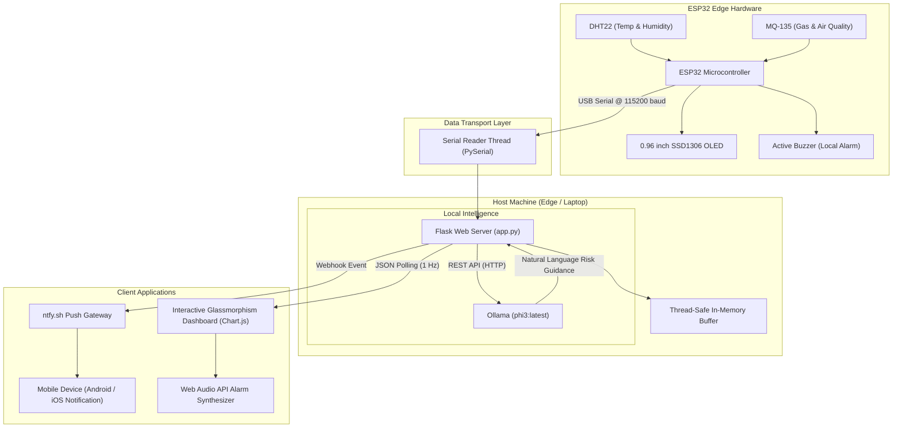
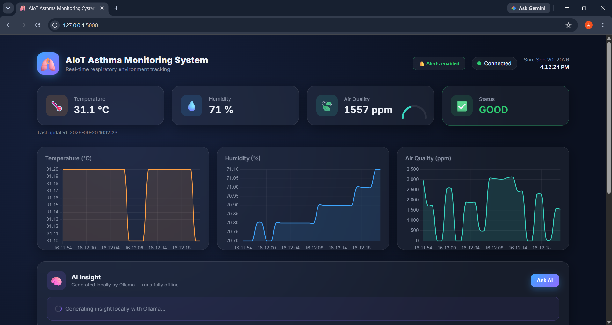
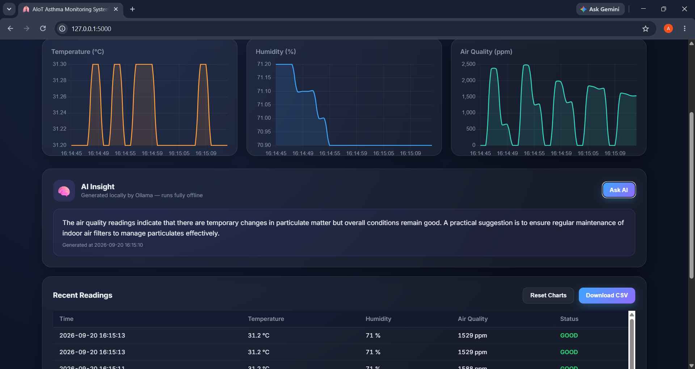
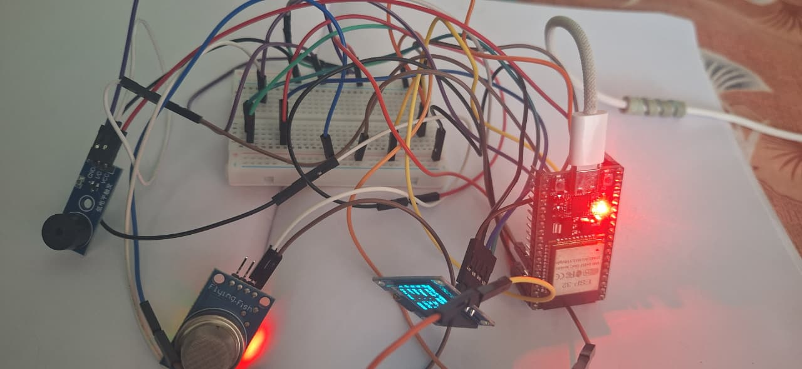
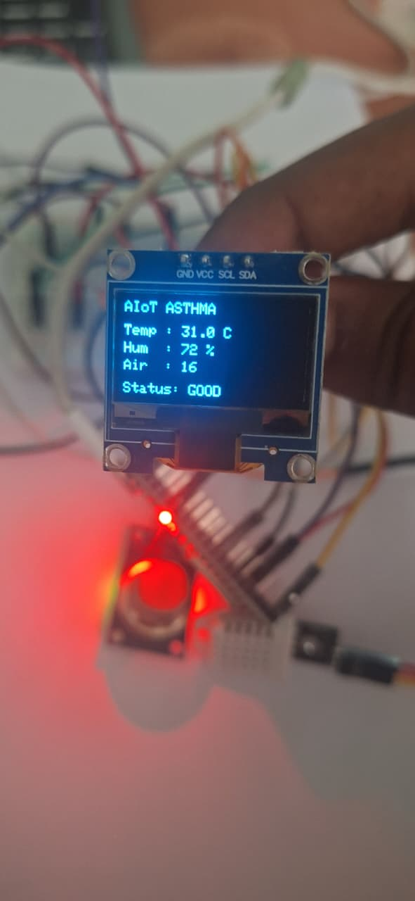
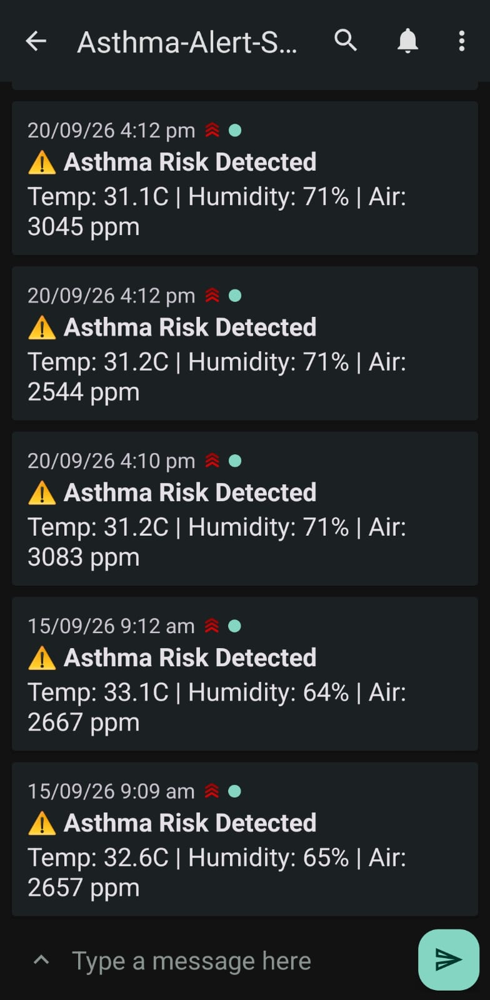

# 🫁 AIoT Asthma Monitoring System

[](https://www.espressif.com/)
[](https://www.python.org/)
[](https://flask.palletsprojects.com/)
[-orange.svg)](https://ollama.com/)
[](https://www.chartjs.org/)
[](https://ntfy.sh/)
[](LICENSE)

An intelligent, real-time **AIoT (Artificial Intelligence of Things)** environmental tracking and risk prevention system engineered for asthma patients and vulnerable respiratory individuals. 

The system couples an **ESP32 microcontroller** reading ambient temperature, humidity, and gas/air pollution with a high-performance **Python Flask backend**, an interactive **Glassmorphism Web Dashboard**, locally-hosted **Generative AI (Ollama)** for risk assessment, and **instant mobile push notifications (ntfy)**.

---

## 📌 Table of Contents

- [Overview](#-overview)
- [System Architecture](#-system-architecture)
- [Key Features](#-key-features)
- [Hardware Setup & Wiring](#-hardware-setup--wiring)
- [Project Structure](#-project-structure)
- [Firmware Setup (ESP32)](#-firmware-setup-esp32)
- [Backend & Dashboard Setup](#-backend--dashboard-setup)
- [Ollama Local AI Setup](#-ollama-local-ai-setup)
- [Mobile Push Notifications Setup](#-mobile-push-notifications-setup)
- [API Reference](#-api-reference)
- [Screenshots & Visuals](#-screenshots--visuals)
- [Troubleshooting](#-troubleshooting)
- [Author & Academic Credits](#-author--academic-credits)
- [License](#-license)

---

## 💡 Overview

Environmental asthma triggers—such as extreme temperatures, high humidity, smoke, VOCs, and airborne contaminants—can provoke acute asthma attacks without advance warning. 

Commercial air monitors are frequently cloud-locked, expensive, and lack personalized health analysis. The **AIoT Asthma Monitoring System** resolves this through an end-to-end local architecture:
1. **Edge Sensing:** ESP32 continuously samples environment parameters (DHT22 & MQ-135) and renders local telemetry to an onboard OLED display.
2. **Serial Telemetry Stream:** Readings are streamed over USB Serial (`115200` baud) to an edge host / laptop.
3. **Web Dashboard:** A responsive Flask application visualizes live sensor gauges, rolling time-series charts, and updates status cards dynamically.
4. **Instant Multi-Channel Alerts:** On detecting hazardous threshold breaches (`ALERT` status), the hardware sounds an active buzzer, the web UI triggers browser audio tones with visual banners, and a push notification is delivered straight to the user's mobile device via `ntfy`.
5. **Local Offline AI Insights:** Uses a local LLM (`phi3` running on Ollama) to interpret environmental trends and generate actionable respiratory health advice—completely private, offline, and zero API costs.

---

## 🏛 System Architecture



---

## ✨ Key Features

- **Real-Time Telemetry:** Continuous sampling (1-second intervals) of temperature (°C), relative humidity (%), and air quality index (ppm).
- **Dual Display Interface:**
  - Hardware OLED (SSD1306 128x64) for standalone bedside monitoring.
  - Web UI with responsive glassmorphic cards and dynamic SVG air quality gauges.
- **Interactive Charting:** Three independent live Chart.js time-series plots tracking 30-sample trends for rapid microclimate pattern recognition.
- **Fail-Safe Alarm System:**
  - Onboard buzzer triggers on hardware edge.
  - In-browser synthesized audio tone (via Web Audio API, zero external MP3 dependencies).
  - Flashing emergency visual banner.
- **Zero-Cloud Push Notifications:** Integrates with `ntfy` for instant notifications on Android and iOS when an `ALERT` threshold is crossed.
- **Offline Generative AI Copilot:** Ollama-powered edge LLM generates concise, calming clinical insights and actionable suggestions from recent sensor trend history.
- **Data Logging & Export:** One-click CSV export with ISO-8601 timestamps for long-term health record review.

---

## 🔌 Hardware Setup & Wiring

### Bill of Materials (BOM)

| Component | Specification | Purpose |
|---|---|---|
| **Microcontroller** | ESP32-WROOM-32 DevKit | Core edge processing & serial data streaming |
| **Temp/Humidity Sensor** | DHT22 (or DHT11) | Environmental thermal & moisture tracking |
| **Air Quality Sensor** | MQ-135 Gas Sensor | Detection of smoke, benzene, ammonia, and VOCs |
| **Local Display** | 0.96" SSD1306 OLED (I2C) | 128x64 standalone bedside telemetry display |
| **Audio Indicator** | 5V Active Buzzer | Instant edge alert upon hazardous readings |
| **Interconnects** | Jumper Wires & Breadboard | Circuit connection |
| **Host Connection** | Micro-USB to USB-A/C Cable | Power and Serial UART data pipeline |

### Pinout Mapping Table

| ESP32 GPIO Pin | Connected Component | Function / Signal |
|:---:|:---:|:---:|
| **GPIO 13** | DHT22 Data Pin | Single-bus Digital Sensor Data |
| **GPIO 34** | MQ-135 `A0` Analog Out | ADC Analog Air Quality Measurement |
| **GPIO 21** | SSD1306 OLED `SDA` | I2C Serial Data |
| **GPIO 22** | SSD1306 OLED `SCL` | I2C Serial Clock |
| **GPIO 25** | Active Buzzer Positive (`+`) | Digital Output (High = Beep) |
| **3V3 / 5V (VIN)** | Sensors & OLED `VCC` | Power Supply Rails |
| **GND** | Common Ground | Ground Reference |

---

## 📂 Project Structure

```text
AIoT-Asthma-Monitoring-System/
├── firmware/
│   └── esp32_asthma_monitor.ino  # ESP32 sketch (OLED, DHT22, MQ-135, Buzzer)
├── static/
│   ├── chart.umd.js              # Bundled Chart.js v4 (offline capability)
│   ├── script.js                 # Frontend polling, Web Audio alarm, Chart.js logic
│   └── style.css                 # Glassmorphism dark-mode UI stylesheet
├── templates/
│   └── index.html                # Main web application dashboard
├── docs/
│   └── images/                   # Hardware photos, architecture, and screenshots
│       ├── dashboard_overview.png
│       ├── charts_and_insights.png
│       ├── hardware_prototype.jpg
│       ├── sensor_node_setup.jpg
│       ├── oled_display.jpg
│       ├── sensor_modules.jpg
│       └── mobile_push_notifications.jpg
├── app.py                        # Python Flask backend, Serial parser, Ollama & ntfy handlers
├── requirements.txt              # Python runtime dependencies
├── .gitignore                    # Version control ignore rules
└── README.md                     # Comprehensive project documentation
```

---

## 💻 Firmware Setup (ESP32)

1. **Install Arduino IDE** (version 2.0+ recommended).
2. **Add ESP32 Board Manager URL:**
   - Go to `File > Preferences > Additional Board Manager URLs`.
   - Add: `https://raw.githubusercontent.com/espressif/arduino-esp32/gh-pages/package_esp32_index.json`
3. **Install Required Libraries** via `Tools > Manage Libraries...`:
   - `Adafruit SSD1306`
   - `Adafruit GFX Library`
   - `DHT sensor library` (Adafruit)
   - `Adafruit Unified Sensor`
4. **Open the Firmware:**
   - Open `firmware/esp32_asthma_monitor.ino`.
5. **Configure & Flash:**
   - Connect ESP32 via USB.
   - Select `Tools > Board > ESP32 Dev Module`.
   - Select your USB COM port under `Tools > Port` (e.g., `COM4`).
   - Click **Upload**.
6. **Verify:**
   - Open the Arduino Serial Monitor at `115200` baud to confirm sensor readings.
   - ⚠️ **Important:** Close the Arduino Serial Monitor before starting the Python backend, as only one application can access the COM port at a time.

---

## 🚀 Backend & Dashboard Setup

### 1. Clone the Repository
```bash
git clone https://github.com/Asswath-03/AIoT-Asthma-Monitoring-System.git
cd AIoT-Asthma-Monitoring-System
```

### 2. Set Up Python Environment
```bash
# Create a virtual environment (optional but recommended)
python -m venv venv

# Activate on Windows:
venv\Scripts\activate

# Activate on macOS/Linux:
source venv/bin/activate
```

### 3. Install Dependencies
```bash
pip install -r requirements.txt
```

### 4. Configure Serial Port
In `app.py`, update `SERIAL_PORT` if your board is assigned to a different COM port:
```python
SERIAL_PORT = "COM4"       # Update to match Windows Device Manager or /dev/ttyUSB0
BAUD_RATE = 115200
```

### 5. Launch the Server
```bash
python app.py
```

Open your browser and navigate to:
```
http://127.0.0.1:5000
```

---

## 🧠 Ollama Local AI Setup

The dashboard integrates **Ollama** to generate local natural-language health insights and risk mitigation guidance without sending telemetry to external cloud servers.

1. **Install Ollama:** Download and install from [ollama.com](https://ollama.com/).
2. **Pull the Model:**
   ```bash
   ollama pull phi3:latest
   ```
3. **Ensure Ollama Service is Running:**
   ```bash
   ollama list
   ```
4. In `app.py`, verify `AI_ENABLED = True` and `OLLAMA_MODEL = "phi3:latest"`.
5. Click the **"Ask AI"** button on the dashboard at any time to generate fresh insights, or wait for an `ALERT` event where insights are triggered automatically.

---

## 📱 Mobile Push Notifications Setup

Real-time smartphone alerts are delivered using **[ntfy.sh](https://ntfy.sh)**, a privacy-focused open-source notification system.

1. Install the **ntfy** application on your device ([Google Play Store](https://play.google.com/store/apps/details?id=io.heckel.ntfy) / [Apple App Store](https://apps.apple.com/us/app/ntfy/id1625396347)).
2. In the ntfy app, subscribe to your topic name: `Asthma-Alert-System` (or a custom private topic of your choice).
3. If using a custom topic, update `NTFY_TOPIC` in `app.py`:
   ```python
   NTFY_TOPIC = "your-custom-topic-name"
   ```
4. Whenever environmental readings breach safety thresholds, your phone will instantly ring with an urgent notification detailing temperature, humidity, and air quality metrics.

---

## 📡 API Reference

The Flask backend exposes the following REST endpoints:

| Endpoint | Method | Response Type | Description |
|---|:---:|:---:|---|
| `/` | `GET` | `text/html` | Serves the main responsive web dashboard |
| `/data` | `GET` | `application/json` | Retrieves latest sensor reading, status flag, and connection state |
| `/history` | `GET` | `application/json` | Returns rolling history buffer (up to 200 readings) |
| `/ai-insight` | `GET` | `application/json` | Fetches current AI analysis state, generated text, or error status |
| `/ai-insight` | `POST` | `application/json` | Manually triggers background LLM analysis of latest readings |
| `/download-csv` | `GET` | `text/csv` | Streams a downloadable CSV file containing all session readings |

---

## 📸 Screenshots & Visuals

### Live Web Dashboard Overview


### Real-Time Charts & Local AI Insight Panel


### Prototype Hardware & Bedside OLED Display
| Complete Hardware Prototype | Onboard OLED Readout |
|:---:|:---:|
|  |  |

### Instant Mobile Push Notifications


---

## 🛠 Troubleshooting

| Problem | Root Cause | Solution |
|---|---|---|
| `[Serial] Connection error on COM4` | Port held by another process or disconnected | Close Arduino IDE Serial Monitor; verify assigned port in Device Manager. |
| Dashboard shows "Connecting..." / stuck | ESP32 not transmitting valid formatted lines | Check Serial output in Arduino IDE to verify baud rate (`115200`) and data format. |
| Ollama AI insight says "Could not reach Ollama" | Ollama daemon not running or model not pulled | Run `ollama list` in terminal and ensure `phi3:latest` is installed. |
| Browser alarm sound does not play | Browser autoplay audio security policy | Click anywhere on the dashboard once to grant audio context permissions. |
| Mobile notifications not received | Phone not subscribed to exact ntfy topic | Verify exact case sensitivity of `NTFY_TOPIC` in both `app.py` and the mobile app. |

---

## 👨‍💻 Author & Academic Credits

- **Developer:** ASSWATH D ([@Asswath-03](https://github.com/Asswath-03))
- **Institution:** Department of Computer Science and Engineering (IoT), Sri Krishna College of Engineering and Technology (SKCET)
- **Course:** 23AD503 – Artificial Intelligence for Internet of Things
- **Year:** 2026 – 2027

---

## 📄 License

This project is licensed under the [MIT License](LICENSE) - see the file for details.
